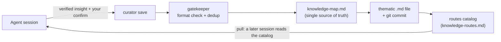

<div align="center">

# Memory Curator

A librarian for your AI agent's knowledge base.

Knowledge from sessions doesn't die with the chat: the model writes,
the curator decides **where it goes**, catches duplicates, commits to
git and keeps an analytics journal.

</div>

[](LICENSE)

> **Status: stable.** A working tool: CLI + `curator-save` skill,
> deterministic checks (no LLM in the backend), fully offline.

---

## What it is

A **session-to-knowledge curation layer**: when a session produces a
verified, reusable insight, the agent proposes it, you confirm, and
Memory Curator files it into *your* existing Markdown knowledge base —
the right thematic file, deduplicated, committed.

It is deliberately **not** a memory platform:

| | Claude Auto Memory / OpenCode Supermemory | Basic Memory | **Memory Curator** |
|---|---|---|---|
| What gets saved | Model decides automatically | Session checkpoints + notes | **You confirm every save** |
| Where it goes | The tool's own store | Its knowledge graph | **Your existing Markdown files** |
| How it returns | Injected into context (search/recall) | Briefings + MCP search | **Pulled on demand via a routes catalog** |
| Background processes | Capture hooks | Sync service | **None. Zero.** |

If you want an agent that "remembers everything automatically", use
those. Memory Curator is for the other half of the problem: durable,
human-owned knowledge that lands where *you* would have put it.

The whole loop, one picture:



## Why

| Pain | Curator answer |
|---|---|
| A hard-won insight dies with the chat — the next session hits the same wall again | The save flow runs *before* the session closes: skill → `curator save` |
| Auto-memory `MEMORY.md` fills with session noise nobody curated | Every save is confirmed by you; the gatekeeper rejects duplicates with a hint |
| Six months in, nobody remembers which file a fact lives in | The topic map routes each fact into the right thematic file — deterministically |
| Knowledge-base edits pile up uncommitted, forever "almost done" | Every save is a git commit; the routes catalog regenerates in the same commit |

## Install

```bash
git clone https://github.com/rodionovss/memory-curator.git
cd memory-curator
uv tool install --force -e ./core   # `curator` CLI on PATH; repo edits apply live
curator install                     # detects opencode / Claude Code: commands, skills, rules
```

The clone is not optional: `curator install` ships commands and rules
from the repo's `integrations/`, and an editable install (`-e`) is what
keeps them reachable. A wheel-only install (`uv tool install ./core`
without `-e`) puts just the CLI on PATH — `curator install` will refuse
to run and tell you so, instead of half-installing silently.

`curator install` requires no configuration: it creates a starter
knowledge base (`~/memory-curator`), a default topic map, `/curator-*`
commands and one memory-rules section in your harness config. No MCP
server, no daemon, no plugins.

## Quick start

Slash commands (appear in your harness after `curator install`):

| Command | What it does |
|---|---|
| `/curator-save` | Extract knowledge from the session → review → confirm → save |
| `/curator-create-map` | Build a project documentation map and wire up routing |
| `/curator-status` | Fact counts by type/status, where the base is |
| `/curator-query "kotlin"` | Search facts before a task |

Terminal:

| Command | What it does |
|---|---|
| `curator status` | Where the base is, fact counts, capture summary |
| `curator save` | Candidates (JSON on stdin, extracted by the agent) → gatekeeper → confirm → save |
| `curator save -y` | Same, no confirmation (scripts / benchmarks) |
| `curator save --doc <path>` | File a knowledge document (map check + commit) |
| `curator get "kotlin"` | Search facts |
| `curator knowledge-routes --write` | Regenerate the routes catalog (not needed after save — it updates itself) |

Verify:

```bash
cd core && python3 -m venv .venv && .venv/bin/pip install -e ".[dev]"
.venv/bin/python -m pytest tests/ -q    # all green
```

## How it works

Content is always written by the model — the curator owns placement and
discipline:

- **Topic map** (`knowledge-map.md`) — the single hand-written source of
  "topic → file" routes. Routing is deterministic: candidate tags ∩
  topic tokens. The routes catalog (`knowledge-routes.md`) is a
  generated read projection of the map — how the agent finds knowledge
  in later sessions.
- **Fact cards**: `curator save --yes` — format validation, dedup
  (word-overlap title match → rejection with a hint), routing,
  write to `.md` + SQLite, git commit. The routes catalog regenerates
  in the same commit, so the read path never goes stale.
- **Knowledge files**: the model writes a topical file (theory +
  pitfalls), then `curator save --doc <path>` checks the path against
  the map, commits and logs the event.
- **Analytics journal** (`analytics.jsonl`) — every event: what was
  proposed, saved, rejected and why.

The knowledge base is plain `.md` files (human-readable, lives in git)
plus a local SQLite card index of titles that powers the dedup check.
Offline by design.

Knowledge base location: `CURATOR_BASE_DIR` env → `~/.curator/config.json`
(written by `curator install`) → default `~/memory-curator`.

## Measured

10 coding tasks with hidden rules, 48 clean-agent runs: without memory
8/10 (traps 0/6), with Memory Curator **10/10 (traps 6/6)**, Fisher
exact p = 0.0011. Methodology: [benchmark/application/](benchmark/application/),
experiment protocols: [benchmark/experiments/](benchmark/experiments/).

## Repository layout

| Path | What |
|------|------|
| `core/` | the Python core: backend, gatekeeper, routing, CLI, installer |
| `.agents/skills/` | harness-agnostic skills (`curator-save`, `mapping-documentation`) |
| `integrations/` | what `curator install` ships: commands, rules section |
| `benchmark/` | experiments: knowledge application, extraction eval, retrieval |

## FAQ

**Why not just let the agent remember?** Auto-memory optimizes for "the
agent recalls"; Curator optimizes for "the human still owns a clean,
navigable base in five years". Different jobs — they compose.

**Does it inject knowledge into every session?** No. One short rules
section points at the routes catalog; the agent reads the catalog when
a task touches a known topic, then opens the source file. Pull, not
push (placement validated by experiment M2 — see
`benchmark/experiments/05-route-placement.md`).

**Which harnesses?** Any agent that can run shell commands and load a
skill: OpenCode and Claude Code are wired out of the box
(`curator install`); the skill is plain Markdown + CLI calls.

**What about project-local docs?** `save --doc` and the
`mapping-documentation` skill route project knowledge into a project
map.

## License

MIT. See [LICENSE](LICENSE).
